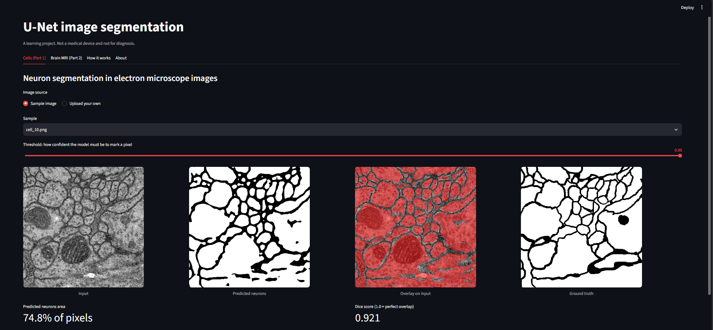
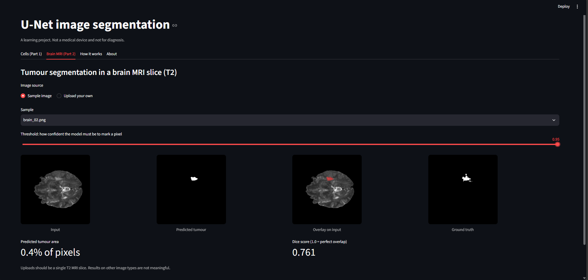

# U-Net Image Segmentation (Cells and Brain MRI)

A PyTorch U-Net project with a Streamlit demo app. It segments neurons in electron
microscope images (Part 1) and tumours in brain MRI slices (Part 2).

> Learning project. Not a medical device and not for diagnosis.

## Demo



## Features
- U-Net built in PyTorch (Part 1: no padding, Part 2: padding and batch normalisation)
- Streamlit app with sample images, image upload, a threshold slider, overlays and a Dice score
- Code split into `model.py`, `predict.py` and `app.py`, so the model can be upgraded easily

## Setup
Run these commands one at a time in a terminal, inside the project folder:

```
python -m venv .venv
.venv\Scripts\activate
python -m pip install -r requirements.txt
python download_weights.py
python -m streamlit run app.py
```

## Project structure
| File | Purpose |
|---|---|
| `model.py` | U-Net architectures |
| `predict.py` | Loading weights, preprocessing and prediction |
| `app.py` | Streamlit interface |
| `download_weights.py` | Downloads the pre-trained weights |
| `unet-code.ipynb`, `unet_brain.ipynb` | Notebooks for exploring and training |

## Credits
Based on a lab from the IBM Skills Network (Ricky Shi, Wojciech "Victor" Fulmyk, Kang Wang).
Datasets: an electron microscopy neuron segmentation set, and BraTS 2020 brain tumour MRI.
The pre-trained weights come from that lab.
